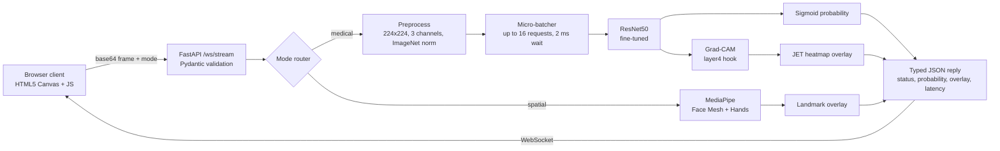

# Multimodal Medical Streaming Engine

A real-time engine for explainable radiological classification and spatial kinematic tracking. A FastAPI WebSocket backend takes image frames from a browser client, processes them in memory and runs one of two pipelines:

- **Radiological mode:** a fine-tuned ResNet50 classifies chest radiographs as normal or pneumonia, and Grad-CAM shows which regions drove the prediction.
- **Spatial mode:** Google MediaPipe extracts face-mesh and hand landmarks for downstream kinematic analysis.

Both modalities share one typed, asynchronous ingestion path but are analyzed independently. Cross-modal fusion is the next research step (see [Roadmap](#roadmap)).

> **Research prototype.** This is not a diagnostic device. All outputs are probabilistic and require expert review. See [CLINICAL_SAFETY_AUDIT.md](CLINICAL_SAFETY_AUDIT.md).

**Full results, experiments and design notes:** [docs/REPORT.md](docs/REPORT.md)

---

## Demo

**Live demo:** [Hugging Face Space](https://huggingface.co/spaces/Farhanitrate0/multimodal-medical-streaming-engine) (single-image diagnosis, batch screening, spatial snapshot). It runs on ZeroGPU with a daily per-visitor allowance; the Docker version below has no limits. Weights: [Farhanitrate0/pneumonia-resnet50](https://huggingface.co/Farhanitrate0/pneumonia-resnet50).


| Spatial Telemetry (Face + Hands) | Early prototype (v1) UI |
|:---:|:---:|
|  |  |

---

## Highlights

| | |
|---|---|
| **Test AUROC** | **0.987** (95% CI 0.978-0.994) on the held-out PneumoniaMNIST test split |
| **Sensitivity / specificity** | 99.0% / 87.2% at a threshold chosen on validation data only |
| **Grad-CAM sanity checks** | Passes parameter randomization (rho -0.03) and patch deletion (AUC 0.447 vs 0.512 random) |
| **Ablation** | 2x2 study shows balanced sampling and full fine-tuning each raise specificity, and the gains add up |
| **v1 failure, root-caused** | Training on 28px images while serving 224px made v1 predict pneumonia for every image; reproduced exactly |
| **Out-of-core loading** | NumPy memmap cache: peak heap 226.5 MB to under 0.1 MB, identical evaluation results |
| **Micro-batching** | About 2x throughput (22.3 vs 11.6 req/s) and half the median latency at 16 concurrent clients |


Details: [evaluation](docs/REPORT.md#evaluation), [sanity checks](docs/REPORT.md#explainability-sanity-checks), [ablation](docs/REPORT.md#ablation-study-what-each-training-change-contributes), [v1 root cause](docs/REPORT.md#root-cause-of-the-v1-collapse-a-resolution-mismatch), [performance](docs/REPORT.md#performance).

---

## System Architecture



- **Async and concurrent:** heavy work runs in worker threads, and each socket handles up to 8 requests at once with request IDs in the replies.
- **Typed contracts:** every message is a Pydantic model; malformed requests get a field-level error without dropping the socket.
- **Small-face tracking:** a full-range detector and zoomed re-mesh recover faces that the default Face Mesh misses.

More in [Serving design](docs/REPORT.md#serving-design).

---

## Repository Structure

| File | Role |
|---|---|
| [main.py](main.py) | FastAPI app: WebSocket endpoint, routing, inference, overlays |
| [schemas.py](schemas.py) | Pydantic request/response models |
| [batcher.py](batcher.py) | Dynamic micro-batcher for radiology requests |
| [tracking.py](tracking.py) | MediaPipe face mesh and hands with small-face fallback |
| [model.py](model.py), [gradcam.py](gradcam.py) | ResNet50 with custom head; batch-aware Grad-CAM |
| [memmap_stream.py](memmap_stream.py) | Out-of-core memmap dataset cache |
| [train.py](train.py), [evaluate.py](evaluate.py), [sanity_checks.py](sanity_checks.py) | Training, held-out evaluation, Grad-CAM checks |
| [ablation.py](ablation.py), [reproduce_v1.py](reproduce_v1.py) | Ablation grid and v1 failure reproduction |
| [bench.py](bench.py) | Ingestion and WebSocket load benchmarks |
| [verifymodel.py](verifymodel.py), [extract.py](extract.py) | Logit-level model check; labeled demo samples |
| [index.html](index.html) | Browser dashboard |
| [app.py](app.py), [hf_space/](hf_space/) | Gradio demo for Hugging Face Spaces |
| [Dockerfile](Dockerfile), [docker-compose.yml](docker-compose.yml) | CPU inference image |

---

## Getting Started

Download the fine-tuned weights (~98 MB) into the project root:
```bash
pip install huggingface_hub
huggingface-cli download Farhanitrate0/pneumonia-resnet50 fine_tuned_medical_resnet.pth --local-dir .
```

**Docker (recommended)**
```bash
docker compose up --build
```
Open <http://localhost:8000>.

**Local Python** (3.10+)
```bash
pip install -r requirements-dev.txt
uvicorn main:app --host 0.0.0.0 --port 8000
```

**Reproduce the results**
```bash
python train.py          # train on 224px PneumoniaMNIST via the memmap cache
python evaluate.py       # test-set metrics and plots -> results/
python sanity_checks.py  # Grad-CAM sanity checks -> results/
python ablation.py       # 2x2 ablation, about 45 min on a consumer GPU
python bench.py ingest   # memmap vs in-memory loading
```

`GET /health` reports the device, weights status and threshold; API docs are at `/docs`.

---

## Tech Stack
- **Backend:** Python, FastAPI, Pydantic, Uvicorn, WebSockets, asyncio, Docker
- **Deep learning:** PyTorch, TorchVision (ResNet50, Grad-CAM)
- **Vision:** Google MediaPipe, OpenCV, Pillow
- **Data:** NumPy memmap, scikit-learn, Matplotlib, [MedMNIST v2: PneumoniaMNIST](https://medmnist.com/)
- **Demo and frontend:** Gradio on Hugging Face Spaces, HTML5, vanilla JavaScript

---

## Limitations
- **Single dataset:** PneumoniaMNIST is pediatric and upsampled; results are not expected to carry over to adult or multi-site data without external validation.
- **No OOD rejection:** non-radiograph images produce meaningless predictions.
- **Specificity and calibration:** most errors are false positives (specificity 87%), ECE is 0.066, and some errors are high-confidence.
- **Shortcut learning:** at least one false positive is driven by an image corner; 7x7 Grad-CAM cannot rule out subtler shortcuts.

## Roadmap
- [x] Held-out evaluation, Grad-CAM sanity checks and a controlled ablation
- [x] Docker deployment, memmap data pipeline, micro-batching and a hosted demo
- [ ] Multi-seed ablation repeats with significance testing (DeLong's test)
- [ ] Temperature scaling and predictive uncertainty to flag confident errors
- [ ] Out-of-distribution detection before inference
- [ ] External validation on an adult chest X-ray dataset (e.g. RSNA Pneumonia Detection)
- [ ] Multimodal fusion of image embeddings with clinical context (e.g. MIMIC-CXR + MIMIC-IV)

---

## Author
**Mohd Farhan Ali**

## License
Code is released under the [MIT License](LICENSE). PneumoniaMNIST is distributed by MedMNIST under CC BY 4.0. For research use only; not a medical device.

## Acknowledgements
- Yang, J. et al. *MedMNIST v2.* Scientific Data, 2023.
- Selvaraju, R. R. et al. *Grad-CAM.* ICCV, 2017.
- Adebayo, J. et al. *Sanity Checks for Saliency Maps.* NeurIPS, 2018.
- Petsiuk, V. et al. *RISE.* BMVC, 2018.
- He, K. et al. *Deep Residual Learning for Image Recognition.* CVPR, 2016.
