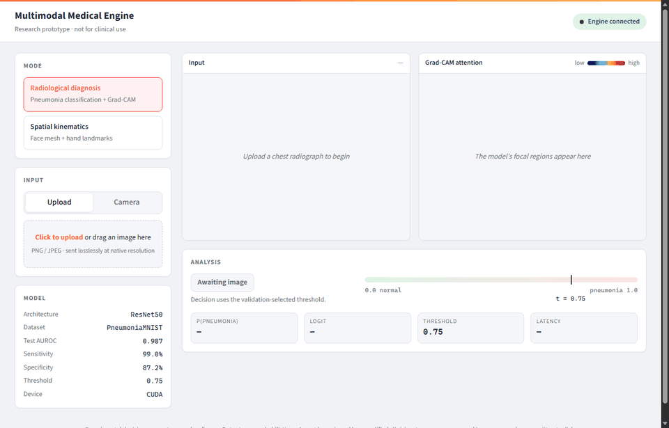
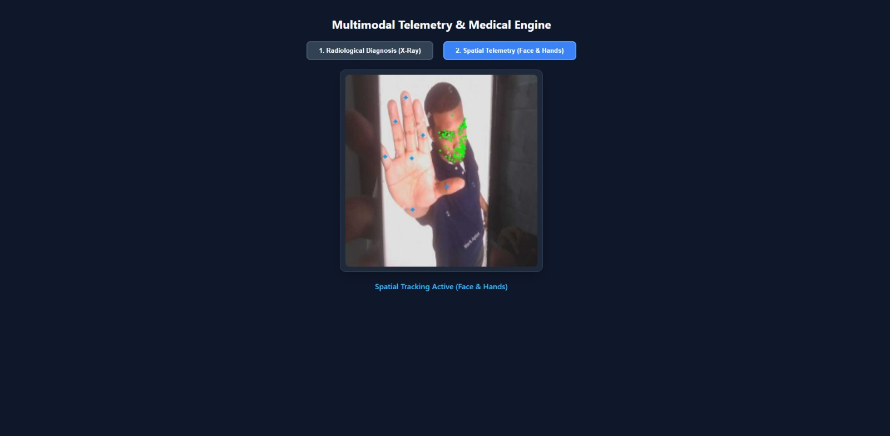
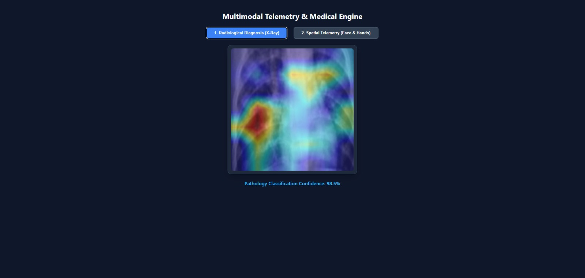
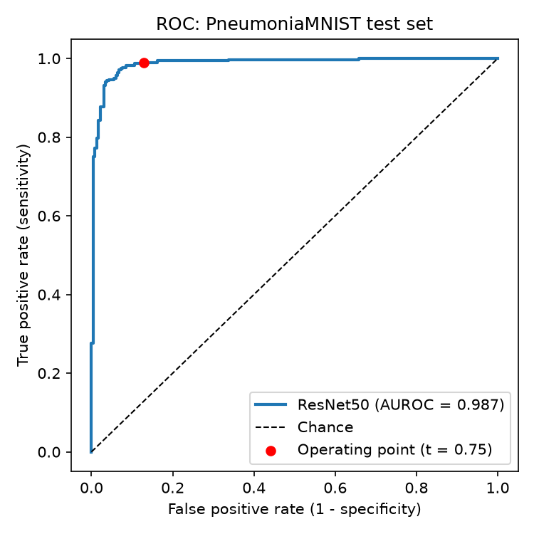
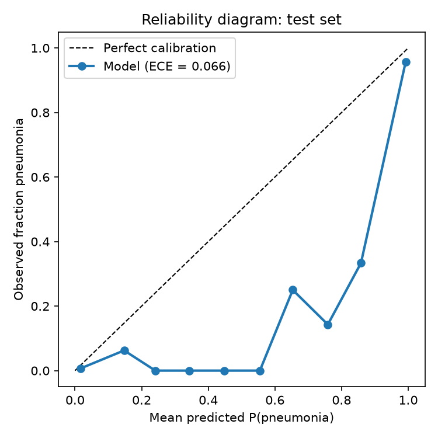
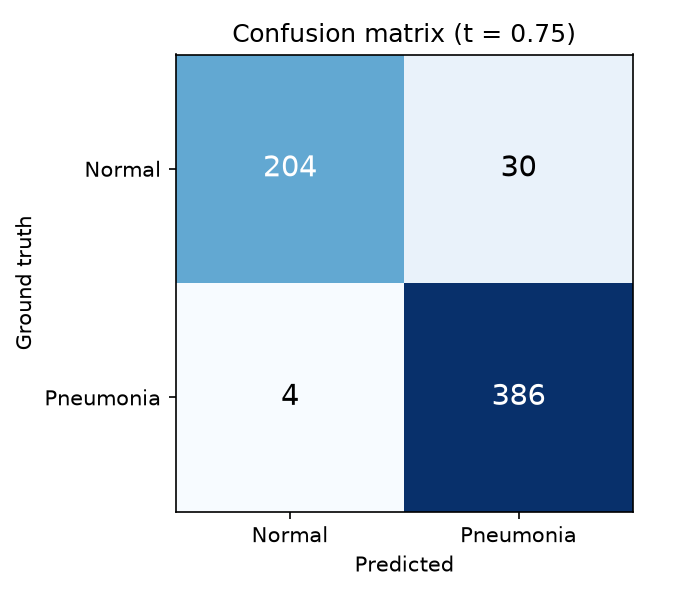
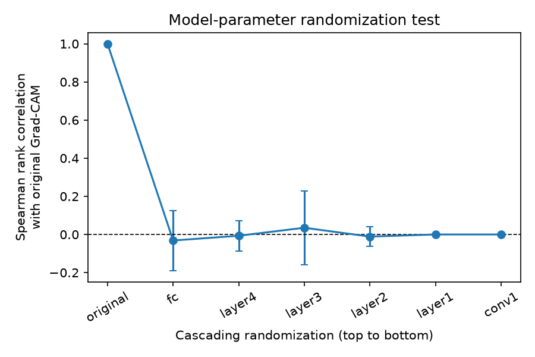
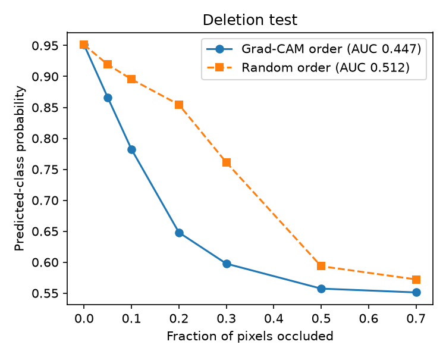
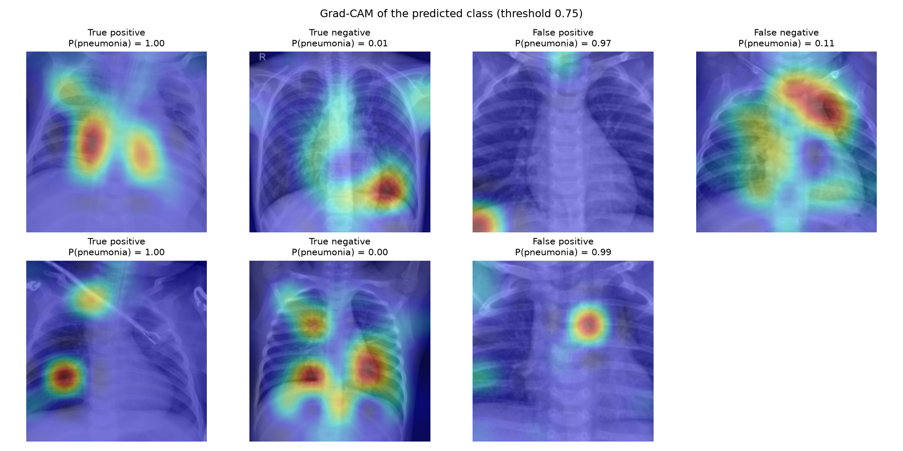
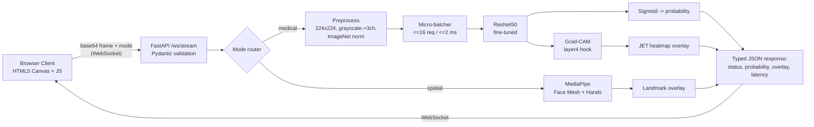

# Multimodal Medical Streaming Engine

A real-time engine for explainable radiological classification and spatial kinematic tracking. A FastAPI WebSocket backend takes image frames from a browser client and processes them in memory. It runs one of two pipelines on each frame:

- **Radiological mode:** a fine-tuned ResNet50 classifies chest radiographs as normal or pneumonia, and Grad-CAM shows which image regions drove the prediction.
- **Spatial mode:** Google MediaPipe extracts face-mesh and hand landmarks for downstream kinematic analysis.

The two modalities (static radiographs and live video kinematics) share one typed, asynchronous ingestion path, but they are analyzed independently. Cross-modal fusion is the next research step (see [Roadmap](#roadmap)).

> **Research prototype.** This is an experimental decision-support framework, not a diagnostic device. All outputs are probabilistic and require expert review. See [CLINICAL_SAFETY_AUDIT.md](CLINICAL_SAFETY_AUDIT.md) for intended use, failure modes and limitations.

---

## Demo

**Live demo:** [huggingface.co/spaces/Farhanitrate0/multimodal-medical-streaming-engine](https://huggingface.co/spaces/Farhanitrate0/multimodal-medical-streaming-engine). This Gradio version on ZeroGPU covers single-image diagnosis, batch screening and a spatial snapshot. The first request after the Space has been idle takes a few seconds to wake up. ZeroGPU gives each visitor a daily GPU allowance (larger when signed in to Hugging Face). Each analysis requests only a 10 s slot, but if the allowance runs out, the Docker version below runs the same model locally without limits. Weights are hosted at [Farhanitrate0/pneumonia-resnet50](https://huggingface.co/Farhanitrate0/pneumonia-resnet50).


*Radiological mode in the real-time dashboard: each uploaded radiograph returns the Grad-CAM of the predicted class, P(pneumonia) against the validation-selected threshold, and the latency. Live model metadata comes from `/health`.*

| Spatial Telemetry (Face + Hands) | Early prototype (v1) UI |
|:---:|:---:|
|  |  |

**Quick start:** `docker compose up --build`, then open <http://localhost:8000> (see [Getting Started](#getting-started)).

---

## Results

Evaluated on the official held-out PneumoniaMNIST test split (n = 624, 62.5% pneumonia) with [evaluate.py](evaluate.py). The decision threshold was chosen on the validation split only (Youden's J), so the test set played no part in any model or threshold choice.

| Metric | Threshold 0.50 | Val-selected threshold (0.75) |
|---|:---:|:---:|
| **AUROC** (95% bootstrap CI) | **0.987** (0.978-0.994) | n/a |
| AUPRC | 0.991 | n/a |
| Accuracy | 93.1% | **94.6%** |
| Sensitivity (recall) | 99.5% | 99.0% |
| Specificity | 82.5% | **87.2%** |
| PPV / NPV | 90.4% / 99.0% | 92.8% / 98.1% |
| F1 | 0.947 | 0.958 |
| Expected calibration error | 0.066 | n/a |

| ROC | Calibration | Confusion matrix |
|:---:|:---:|:---:|
|  |  |  |

**What the numbers show:** the model ranks cases very well (AUROC 0.987) and rarely misses pneumonia (4 of 390 at the selected threshold). Its main errors are false positives on normal radiographs (30 of 234). That trade-off suits screening, but it means normal studies are over-called. Moving the threshold from 0.5 to the validation-selected value reduces false positives by 27% at a cost of two more false negatives.

### Explainability sanity checks

Run with [sanity_checks.py](sanity_checks.py) on 100 class-balanced test images:

| Test | Result | Interpretation |
|---|---|---|
| **Cascading parameter randomization** (Adebayo et al., 2018) | Spearman rho between original and randomized heatmaps falls from 1.0 to **-0.03 +/- 0.16** once the head is randomized, and stays ~0 through every layer down to `conv1` | Passes. The heatmaps depend on the learned weights, so they are not just edge detectors. |
| **Patch-deletion faithfulness** (Petsiuk et al., 2018) | Deletion AUC **0.447** (Grad-CAM order) vs **0.512** (random order). At 20% occlusion, predicted-class probability is 0.65 vs 0.85. | Passes. Occluding the regions Grad-CAM marks lowers confidence much faster than occluding random regions. |

| Randomization test | Deletion curve |
|:---:|:---:|
|  |  |



**A shortcut-learning case:** in one false positive (top row, third panel), Grad-CAM attention sits on the image corner rather than the lung fields. This is a "Clever Hans" failure and the reason explainability is built into the serving path rather than added afterward.

### Ablation study: what each training change contributes

[ablation.py](ablation.py) retrains a 2x2 grid that isolates the two v2 training changes. Every run uses the same seed (42), data, augmentation, optimizer (AdamW, lr 1e-5), scheduler, 15-epoch budget and best-validation-loss checkpointing, and is evaluated with the protocol above.

| Sampler | Backbone | Trainable params | Test AUROC | Sens @0.5 | Spec @0.5 | Spec @val-thr | ECE |
|---|---|:---:|:---:|:---:|:---:|:---:|:---:|
| natural (3:1) | partial (layer4 + head) | 16.0M | 0.979 | 0.992 | 0.761 | 0.833 | 0.082 |
| balanced | partial | 16.0M | 0.983 | 0.987 | 0.816 | 0.897 | 0.066 |
| natural (3:1) | full | 24.6M | 0.983 | 0.992 | 0.791 | 0.880 | 0.071 |
| **balanced** | **full** (v2) | 24.6M | **0.988** | 0.992 | **0.842** | **0.906** | **0.061** |

**Findings**
- **The cost of class imbalance is specificity.** Sensitivity stays at about 99% in every setting. Without balancing, the model over-calls pneumonia on normal radiographs. Balanced sampling raises specificity at 0.5 by +5.5 points (partial backbone) and +5.1 points (full backbone), and improves calibration in both cases.
- **Full fine-tuning helps independently** (+3.0 / +2.6 specificity points), and the two changes add up: the v2 configuration is best on every ranking and calibration metric.
- **Imbalance biases but does not collapse:** none of the four configurations collapsed to a constant prediction (predicted-positive rate 0.68-0.71 against a prevalence of 0.625). So the collapse seen in v1 needed another explanation, which the next experiment found.

### Root cause of the v1 collapse: a resolution mismatch

The original v1 `train.py` built the dataset as `PneumoniaMNIST(split='train', ...)` without `size=224`, so MedMNIST loaded its default 28x28 images, and `Resize((224, 224))` upscaled them into heavily blurred inputs. The server, however, received sharp full-resolution radiographs. [reproduce_v1.py](reproduce_v1.py) re-runs the exact v1 recipe (28px data, 3 epochs, lr 1e-4, partial backbone, last-epoch weights) and tests the resulting model at both resolutions:

| v1 model tested on | AUROC | Sensitivity | Specificity | Predicted pneumonia |
|---|:---:|:---:|:---:|:---:|
| 28px test images (matches training) | 0.929 | 0.990 | 0.543 | 79.0% |
| **224px test images (what the server sends)** | 0.824 | 1.000 | **0.000** | **100%** |

At serving resolution the v1 model labels every radiograph as pneumonia, which reproduces the observed collapse exactly. The cause was training-serving skew in image resolution, not tensor-shape broadcasting (which `BCEWithLogitsLoss` does not allow) and not class imbalance. v2 trains on native 224x224 images (`size=224`), so training and serving see the same distribution. Balanced sampling and full fine-tuning then add the specificity gains shown above.

**Caveats:** these are single-seed runs. AUROC differences between variants (<= 0.009) fall inside the bootstrap CI width (~0.016), so they are suggestive rather than significant. Specificity gains are computed on 234 normal test images (5 points ~12 images). Multi-seed repeats are on the roadmap. Across all runs, validation AUROC (~0.998) was clearly higher than test AUROC (~0.98), which suggests a distribution shift between the PneumoniaMNIST validation and test splits.

> **Methodology note:** an earlier version of the deletion test used pixel-wise random occlusion. That creates salt-and-pepper noise which pushed the model to a constant output (p ~0.56) at only 5% occlusion, whatever the location. The test therefore measured image corruption rather than attribution. Both orderings now occlude contiguous 16x16 patches filled with a blurred copy of the image.

---

## Performance

Measured with [bench.py](bench.py) on a Windows laptop (i5-13450HX, RTX 4050 Laptop GPU). Raw numbers are in [results/benchmark.json](results/benchmark.json).

**Out-of-core data loading.** MedMNIST ships each dataset as a compressed `.npz`, so even with its `mmap_mode` option the whole split is decompressed into RAM (verified: `np.load` ignores `mmap_mode` for zip archives). [memmap_stream.py](memmap_stream.py) streams each split, chunk by chunk, into an uncompressed `.npy` cache once. After that, training and evaluation read images through `np.memmap`, so only the pages a batch touches are loaded.

| Train split, 4,708 images at 224x224 | Open time | Peak heap | Read throughput |
|---|:---:|:---:|:---:|
| MedMNIST in-memory | 6.4 s | 226.5 MB | 55k images/s |
| **memmap cache** | **0.01 s** | **< 0.1 MB** | 42k images/s |

The memmap cache is pixel-identical to MedMNIST, and re-running the evaluation through it reproduces `results/metrics.json` exactly. Full fine-tuning consumes about 110 images/s on this GPU (43 s per epoch in [ablation/run_log.txt](ablation/run_log.txt)), so memmap reads are not the bottleneck. Because only touched pages are loaded, the same loader works for datasets larger than RAM.

**Serving throughput with dynamic micro-batching.** Batch-1 GPU inference on this machine is limited by kernel-launch overhead rather than compute (about 50 ms per image at batch 1 vs 3.9 ms per image at batch 32). [batcher.py](batcher.py) therefore groups radiology requests that arrive while the GPU is busy into a single Grad-CAM forward/backward pass (up to 16 images, at most 2 ms of extra wait). Batched Grad-CAM matches per-image Grad-CAM to within 2e-5 in full FP32.

| Radiology mode, concurrent WebSocket clients | 1 | 4 | 8 | 16 |
|---|:---:|:---:|:---:|:---:|
| Throughput, batching off (req/s) | 6.5 | 11.1 | 11.6 | 11.6 |
| **Throughput, micro-batching (req/s)** | 6.3 | 13.5 | 18.2 | **22.3** |
| p50 latency, batching off (ms) | 154 | 345 | 666 | 1372 |
| **p50 latency, micro-batching (ms)** | 158 | 259 | 410 | **680** |

At 16 clients, micro-batching roughly doubles throughput and halves median latency, and the single-client difference is within measurement noise (158 vs 154 ms). Spatial mode (MediaPipe on CPU) runs at about 8 frames/s for a single client on the same machine, which is above the dashboard's 5 FPS camera cap. Both configurations ran back to back with server and client pinned to performance cores. Absolute numbers vary with the laptop's power state (single-client throughput reached 44 req/s in other runs), so compare rows within a table rather than across machines.

---

## System Architecture



- **Non-blocking inference:** decoding, MediaPipe and overlay rendering run in worker threads through `asyncio.to_thread`, so the event loop keeps serving other sockets.
- **Concurrent messages per socket:** each socket handles up to 8 requests at once (`MAX_IN_FLIGHT`), and replies carry the request `id`, so a client can pipeline a whole batch and match results that arrive out of order.
- **Typed contracts:** every WebSocket message and reply is a Pydantic model ([schemas.py](schemas.py)). Malformed requests get a precise error such as `Invalid request (mode): Input should be 'medical' or 'spatial'`, and the socket stays open.
- **In-memory processing:** the engine decodes frames from base64 straight into RAM and does not write diagnostic frames or landmark coordinates to disk. (The hosted Gradio demo is different: Gradio stores uploads in temporary files, so do not upload real patient data there.)

---

## Project Evolution

The project was built in stages. The baseline proof of concept worked end to end but had failure modes that made its predictions unreliable. The current version addresses each of them.

### Baseline (v1): Proof of Concept
- A FastAPI WebSocket server that streamed webcam frames only, at the full browser frame rate.
- An ImageNet-pretrained ResNet50 with a frozen backbone and a new classification head, trained on PneumoniaMNIST.
- Grad-CAM heatmaps and MediaPipe face/hand tracking in a basic HTML frontend.

**Problems found in the baseline:**

| Problem | Root cause |
|---|---|
| **Model collapse:** the deployed model predicted *pneumonia* for every radiograph | Training used MedMNIST's default **28x28** images upscaled to 224, while the server sent sharp full-resolution images, a resolution training-serving skew ([reproduced](#root-cause-of-the-v1-collapse-a-resolution-mismatch)) |
| **Bias toward the majority class:** low specificity even at matched resolution | A ~3:1 pneumonia-to-normal class imbalance, passed straight into every mini-batch by unbalanced sampling (quantified in the [ablation study](#ablation-study-what-each-training-change-contributes)) |
| **Weak domain adaptation** | Most of the backbone kept frozen ImageNet filters that were not tuned to radiographic opacity patterns |
| **WebSocket backpressure / lag** | The client sent frames at ~30 FPS, faster than the server could run inference |
| **Training-serving skew** | Webcam capture and lossy JPEG compression added artifacts and lost fine radiological detail that the model never saw during training |

### Current (v2): What Was Added

**1. Training-pipeline rework ([train.py](train.py))**
- **Native-resolution training data:** trains on PneumoniaMNIST at 224x224 instead of the default 28x28. This removes the resolution skew that caused the v1 collapse. The images are streamed from an out-of-core memmap cache ([memmap_stream.py](memmap_stream.py)) rather than held in RAM.
- **Validation split:** v1 trained for 3 epochs and kept the last checkpoint. v2 tracks validation loss and AUROC every epoch.
- **Class-balanced sampling:** a `WeightedRandomSampler` with inverse-frequency weights gives each mini-batch a roughly 50/50 class balance.
- **Explicit tensor shapes:** logits and labels are both flattened with `.view(-1)` before `BCEWithLogitsLoss`. This is defensive: `BCEWithLogitsLoss` rejects mismatched shapes rather than broadcasting, and MedMNIST labels already batch to `(B, 1)`, so it doesn't change the loss here. It does protect against silent broadcasting if the loss is later swapped for one that broadcasts (for example, a hand-written loss or `MSELoss`).
- **Full-backbone fine-tuning:** all ResNet50 layers are unfrozen and trained with AdamW at a low learning rate (`1e-5`, weight decay `1e-2`) to adapt the ImageNet features to X-ray texture without catastrophic forgetting.
- **Regularized head:** `Linear(2048->512) -> BatchNorm -> ReLU -> Dropout(0.3) -> Linear(512->1)`.
- **Training controls:** `ReduceLROnPlateau` scheduling, light augmentation (horizontal flip, brightness/contrast jitter), and checkpointing on best validation loss. Trained for 15 epochs on 224x224 PneumoniaMNIST.

**2. Lossless clinical ingestion pipeline ([index.html](index.html))**
- **Static file upload mode** with drag-and-drop for radiographs. Uploads are sent as lossless PNG at native resolution (`canvas.toDataURL('image/png')`), so the serving input matches the training distribution.
- **Throttled webcam mode:** frames are capped at 5 FPS with a client-side scheduler, which removes socket backlog.

**3. Evaluation and verification tooling**
- [evaluate.py](evaluate.py) is a held-out test-set evaluation. It reports AUROC with a bootstrap CI, AUPRC, sensitivity, specificity, PPV/NPV, F1 and ECE, selects the threshold on validation data, and saves ROC, PR, reliability and confusion-matrix plots.
- [sanity_checks.py](sanity_checks.py) runs the Grad-CAM randomization and deletion tests and produces a TP/TN/FP/FN example panel.
- [verifymodel.py](verifymodel.py) runs the model with pure PyTorch, bypassing the server and UI. It prints raw logits and probabilities, so serving-path problems can be separated from model problems.
- [extract.py](extract.py) exports a labeled demo set (confident hits plus the hardest mistakes) to `samples/`.

**4. Explainability and serving fixes ([gradcam.py](gradcam.py), [main.py](main.py))**
- Grad-CAM now explains the predicted class: for a single-logit head it backpropagates `+z` for pneumonia and `-z` for normal. Previously, normal predictions showed residual pneumonia evidence.
- The heatmap and the prediction come from one forward pass, and Grad-CAM is batch-aware, so concurrent requests share a GPU pass through the dynamic micro-batcher ([batcher.py](batcher.py)). A lock serializes the hook state.
- The server uses the validation-selected threshold from `results/metrics.json` and returns `probability`, `logit`, `threshold` and `prediction` alongside the overlay.
- Medical overlays are returned as lossless PNG at native resolution. Spatial mode returns the raw normalized face and hand landmark coordinates for downstream kinematic analysis.
- Face Mesh's built-in detector is short-range and misses faces that fill only a small part of the frame. [tracking.py](tracking.py) falls back to MediaPipe's full-range face detector, re-runs the mesh on an upscaled crop and maps the landmarks back to the full image. On a full-body test photo this recovers all 478 landmarks of a face about 30 px wide that the default pipeline missed.
- Requests, replies and `/health` are Pydantic models ([schemas.py](schemas.py)). Malformed payloads return a field-level error without dropping the socket. A thread lock guards the MediaPipe graphs. `/health` reports the device, weights status, threshold, model card and mean batch size.

**5. Clinical-style dashboard ([index.html](index.html))**
- A light clinical theme: a sidebar for mode, input and the model card, with the viewer and analysis panels beside it.
- The input and the Grad-CAM output are shown side by side, with a colormap legend. A probability bar marks the decision threshold. Readouts show the probability, logit, threshold and latency, and a model card comes from `/health`.
- **Input sources match each mode:** radiology uses lossless file upload (click or drag-and-drop) by default, and kinematics uses the live camera. In radiology mode the camera is labeled *experimental* and analyzes only a single captured still, because live screen capture adds motion, glare and moire that the model never saw in training.
- **Batch screening:** drop up to 100 radiographs at once. Each is sent with a request ID, the server processes them concurrently on the same socket (so they share micro-batched GPU passes), and the results fill a thumbnail strip color-coded by prediction. You can step through them with the arrow keys, swipe on mobile, read a running summary (*n pneumonia suspected / n normal*, images per second), and export everything as CSV.
- The camera stream allows at most one frame in flight (5 FPS cap), so it doesn't build up a backlog. The connection status is real, and the socket reconnects automatically.
- An on-screen research-use disclaimer is included, and the layout is responsive down to phone width.

**6. Containerized deployment ([Dockerfile](Dockerfile))**
- A CPU-only PyTorch image runs as a non-root user and has a health check. Weights are copied from the build context or downloaded through `--build-arg WEIGHTS_URL`.
- The serving path no longer downloads ImageNet weights at startup (`get_medical_model(pretrained=False)`), so the container starts offline. A warm-up inference at startup avoids a slow first request.

**7. Safety and explainability documentation**
- [CLINICAL_SAFETY_AUDIT.md](CLINICAL_SAFETY_AUDIT.md) covers intended use, "Clever Hans" shortcut-learning risks (for example, attention on borders or watermarks instead of the lung fields), the privacy design and known failure modes.

---

## Repository Structure

| File | Role |
|---|---|
| [main.py](main.py) | FastAPI app: WebSocket endpoint, mode routing, inference, Grad-CAM overlay rendering |
| [schemas.py](schemas.py) | Pydantic request/response models for the stream and `/health` |
| [batcher.py](batcher.py) | Dynamic micro-batcher that groups concurrent radiology requests into one GPU pass |
| [tracking.py](tracking.py) | MediaPipe face mesh and hands, with a full-range detector and zoomed re-mesh for small or distant faces |
| [model.py](model.py) | ResNet50 backbone with a custom classification head |
| [gradcam.py](gradcam.py) | `GradCAMEngine`: batch-aware forward/backward hooks on `layer4[-1]` that generate class-activation heatmaps |
| [memmap_stream.py](memmap_stream.py) | Out-of-core dataset cache: chunked `.npz` -> `.npy` conversion and a lazy `np.memmap` dataset |
| [train.py](train.py) | Class-balanced fine-tuning loop on PneumoniaMNIST (224x224) |
| [evaluate.py](evaluate.py) | Held-out test evaluation: metrics, bootstrap CI, calibration, plots -> `results/` |
| [sanity_checks.py](sanity_checks.py) | Grad-CAM parameter-randomization and deletion tests, example panel -> `results/` |
| [ablation.py](ablation.py) | 2x2 ablation (sampler x backbone depth), with per-epoch logs and results -> `ablation/` |
| [reproduce_v1.py](reproduce_v1.py) | Re-runs the original v1 recipe and tests it at 28px vs 224px -> `ablation/v1_reproduction.json` |
| [verifymodel.py](verifymodel.py) | Standalone logit-level model check, independent of the server |
| [extract.py](extract.py) | Exports a labeled demo set (TN / TP / hardest FP / FN) from the test split -> `samples/` |
| [bench.py](bench.py) | Ingestion benchmark (memmap vs in-memory) and concurrent WebSocket load test -> `results/benchmark.json` |
| [index.html](index.html) | Browser dashboard: upload / drag-and-drop and camera ingestion, results and telemetry UI |
| [Dockerfile](Dockerfile), [docker-compose.yml](docker-compose.yml) | CPU inference image with a health check |
| [app.py](app.py), [hf_space/](hf_space/) | Gradio version for the hosted demo on Hugging Face Spaces: single-image diagnosis, batch screening (gallery + CSV) and a spatial snapshot |
| [requirements.txt](requirements.txt) / [requirements-dev.txt](requirements-dev.txt) | Serving dependencies / training and evaluation dependencies |

---

## Getting Started

The fine-tuned weights (`fine_tuned_medical_resnet.pth`, ~98 MB) are hosted on Hugging Face at [Farhanitrate0/pneumonia-resnet50](https://huggingface.co/Farhanitrate0/pneumonia-resnet50) rather than stored in git. Download them into the project root before running the engine, or retrain with `train.py`:
```bash
pip install huggingface_hub
huggingface-cli download Farhanitrate0/pneumonia-resnet50 fine_tuned_medical_resnet.pth --local-dir .
```

### Option A: Docker (recommended)
```bash
docker compose up --build          # or: docker build -t medical-engine . && docker run -p 8000:8000 medical-engine
```
Open <http://localhost:8000>. The image runs CPU inference (roughly 0.1-0.25 s per radiograph on a laptop CPU). To fetch the weights during the build instead of copying them:
```bash
docker build --build-arg WEIGHTS_URL=https://huggingface.co/Farhanitrate0/pneumonia-resnet50/resolve/main/fine_tuned_medical_resnet.pth -t medical-engine .
```

### Option B: Local Python

#### 1. Install dependencies
Python 3.10+ is required. For GPU training, install the matching PyTorch build from [pytorch.org](https://pytorch.org/get-started/locally/) first.
```bash
pip install -r requirements-dev.txt
```

#### 2. (Optional) Retrain the model
```bash
python train.py          # downloads PneumoniaMNIST (224px), builds the memmap cache in data/, writes fine_tuned_medical_resnet.pth
```

#### 3. Evaluate
```bash
python evaluate.py       # test-set metrics + plots -> results/ (also sets the serving threshold)
python sanity_checks.py  # Grad-CAM sanity checks -> results/
python extract.py        # labelled demo set -> samples/ (see samples/samples.json)
python verifymodel.py    # logit-level check of every sample, bypassing the server
```
`samples/` contains confident true negatives (`normal_*.png`) and true positives (`pneumonia_*.png`), plus the model's hardest mistakes, kept deliberately: `hardcase_fp_*.png` are normals called pneumonia, and `hardcase_fn_*.png` are missed pneumonias. Upload any of them to the dashboard. All are byte-exact 224x224 test-split images.

To reproduce the ablation (about 45 minutes on a consumer GPU; it never overwrites the production weights):
```bash
python ablation.py       # 4 runs x 15 epochs -> ablation/*.json, ablation/summary.md
```

#### 4. Run the engine
```bash
uvicorn main:app --host 0.0.0.0 --port 8000
```
Open <http://localhost:8000>. Pick a mode, then upload a radiograph or start the camera. Check `GET /health` for the device, whether weights loaded, the active threshold, and the model's test metrics. Interactive API docs generated from the Pydantic schemas are at `/docs`.

#### 5. Benchmark
```bash
python bench.py ingest                                          # memmap vs in-memory loading
python bench.py server --url ws://127.0.0.1:8000/ws/stream      # concurrent clients, both modes
MAX_BATCH=1 uvicorn main:app --port 8001                        # baseline with batching off
```

---

## Tech Stack
- **Backend:** Python, FastAPI, Pydantic, Uvicorn, WebSockets, asyncio, Docker
- **Deep learning:** PyTorch, TorchVision (ResNet50, Grad-CAM)
- **Spatial tracking:** Google MediaPipe (Face Mesh, Hands)
- **Computer vision:** OpenCV, Pillow
- **Data:** NumPy memmap (out-of-core loading), scikit-learn, Matplotlib
- **Dataset:** [MedMNIST v2: PneumoniaMNIST](https://medmnist.com/)
- **Hosted demo:** Gradio on Hugging Face Spaces
- **Frontend:** HTML5, vanilla JavaScript, Canvas API

---

## Limitations
- **Dataset scale and resolution:** PneumoniaMNIST is upsampled from lower-resolution pediatric chest X-rays. Performance is not expected to carry over to adult or multi-site clinical data without further validation.
- **Out-of-distribution inputs:** non-radiograph images produce meaningless predictions and unstable heatmaps. The system has no OOD rejection yet.
- **Specificity gap:** most errors are false positives on normal radiographs (specificity 87%). The model is also moderately miscalibrated (ECE 0.066).
- **Confident errors:** misclassifications are often high-confidence. The hardest false positives score P(pneumonia) ~0.99 and the hardest false negative scores 0.005 (see `samples/`). So the probability alone cannot flag unreliable predictions, which motivates the calibration and uncertainty items on the roadmap.
- **Shortcut learning:** at least one false positive is driven by an image corner rather than anatomy. Grad-CAM at 7x7 resolution is coarse and cannot rule out subtler shortcuts.
- **Webcam capture of screens:** glare, moire, perspective tilt and hand shake from filming a monitor are out-of-distribution and make predictions unstable. The dashboard therefore restricts radiology-mode camera input to single captured stills and marks it experimental. Use file upload for evaluation.

## Roadmap
- [x] Held-out test-set evaluation (AUROC, sensitivity, specificity, calibration) and reporting
- [x] Grad-CAM sanity checks (model-parameter randomization, patch-deletion faithfulness)
- [x] Controlled ablation of the training changes (class-balanced sampling x backbone depth)
- [ ] Multi-seed repeats of the ablation, with significance testing (DeLong's test for AUROC)
- [ ] Post-hoc calibration (temperature scaling) and predictive uncertainty (MC dropout / deep ensembles) to flag confident errors
- [ ] Out-of-distribution detection before inference
- [ ] External validation on an independent adult chest X-ray dataset (e.g. RSNA Pneumonia Detection) to measure cross-site generalization
- [ ] Multimodal fusion: combine image embeddings with clinical context (age, vitals, symptoms) through late fusion, evaluated on paired data such as MIMIC-CXR + MIMIC-IV, and compare against image-only performance
- [x] Containerized deployment (Docker)
- [x] Out-of-core data pipeline (NumPy memmap) and dynamic micro-batching for serving
- [x] Public hosted demo (Hugging Face Spaces)

---

## Author
**Mohd Farhan Ali**

## License
Code is released under the [MIT License](LICENSE). PneumoniaMNIST is distributed by MedMNIST under CC BY 4.0. This software is provided for research use only and is not a medical device.

## Acknowledgements
- Yang, J. et al. *MedMNIST v2: A large-scale lightweight benchmark for 2D and 3D biomedical image classification.* Scientific Data, 2023.
- Selvaraju, R. R. et al. *Grad-CAM: Visual Explanations from Deep Networks via Gradient-based Localization.* ICCV, 2017.
- Adebayo, J. et al. *Sanity Checks for Saliency Maps.* NeurIPS, 2018.
- Petsiuk, V., Das, A., Saenko, K. *RISE: Randomized Input Sampling for Explanation of Black-box Models.* BMVC, 2018.
- He, K. et al. *Deep Residual Learning for Image Recognition.* CVPR, 2016.
