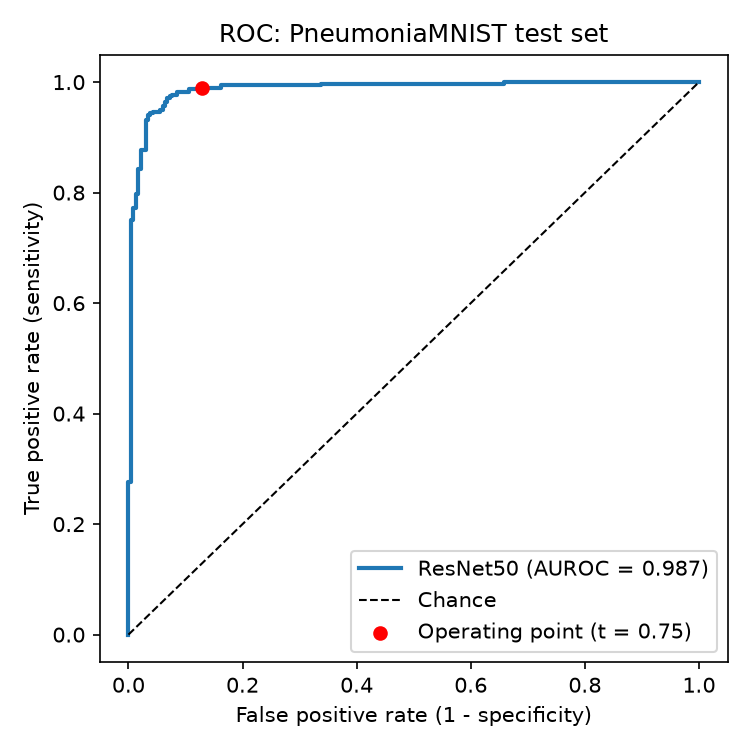
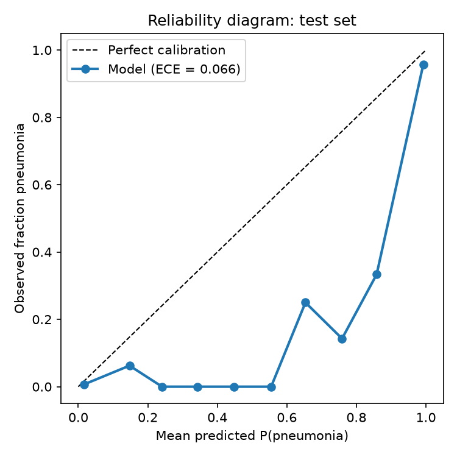
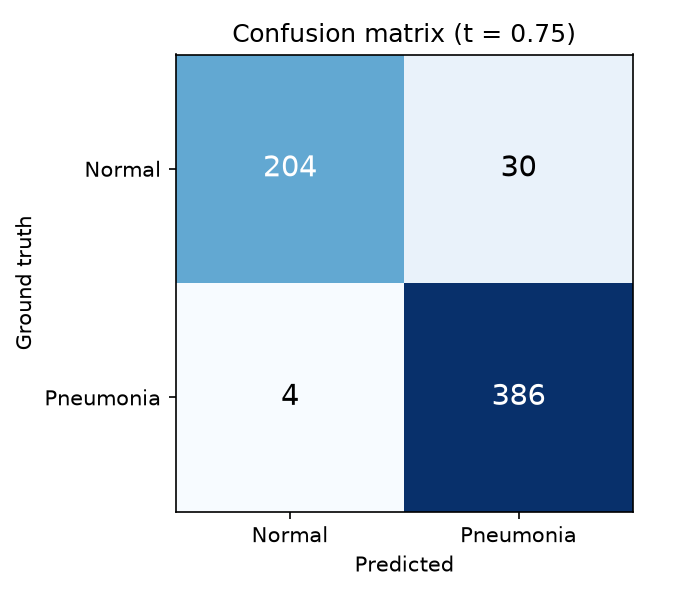
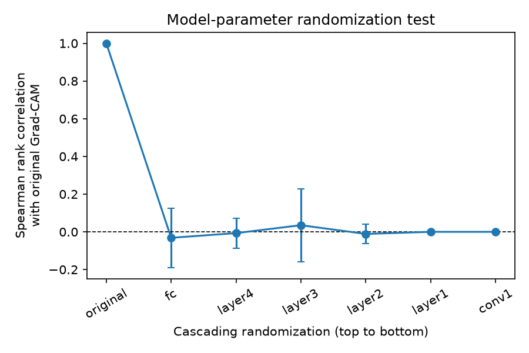
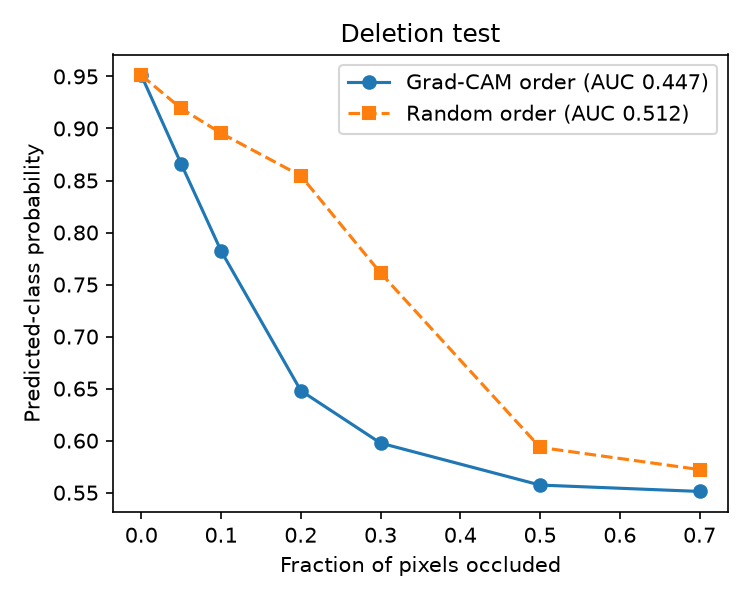
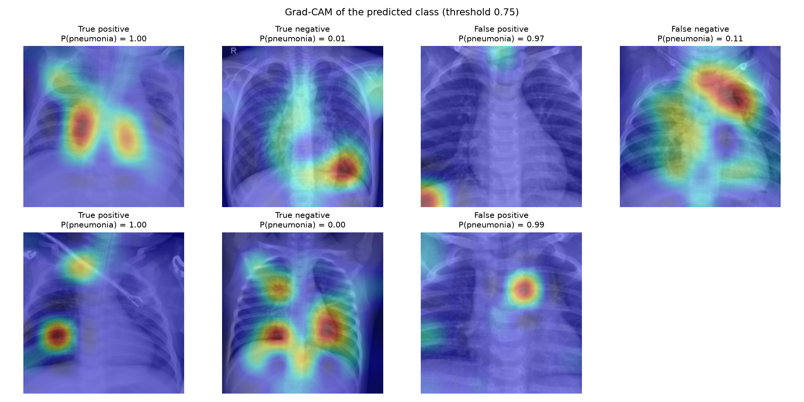

# Technical Report

Detailed results, experiments and design notes for the [Multimodal Medical Streaming Engine](../README.md).

## Contents
- [Evaluation](#evaluation)
- [Explainability sanity checks](#explainability-sanity-checks)
- [Ablation study](#ablation-study-what-each-training-change-contributes)
- [Root cause of the v1 collapse](#root-cause-of-the-v1-collapse-a-resolution-mismatch)
- [Performance](#performance)
- [Serving design](#serving-design)
- [Project evolution](#project-evolution)

---

## Evaluation

Evaluated on the official held-out PneumoniaMNIST test split (n = 624, 62.5% pneumonia) with [evaluate.py](../evaluate.py). The decision threshold was chosen on the validation split only (Youden's J), so the test set played no part in any model or threshold choice.

| Metric | Threshold 0.50 | Val-selected threshold (0.75) |
|---|:---:|:---:|
| **AUROC** (95% bootstrap CI) | **0.987** (0.978-0.994) | n/a |
| AUPRC | 0.991 | n/a |
| Accuracy | 93.1% | **94.6%** |
| Sensitivity (recall) | 99.5% | 99.0% |
| Specificity | 82.5% | **87.2%** |
| PPV / NPV | 90.4% / 99.0% | 92.8% / 98.1% |
| F1 | 0.947 | 0.958 |
| Expected calibration error | 0.066 | n/a |

| ROC | Calibration | Confusion matrix |
|:---:|:---:|:---:|
|  |  |  |

**What the numbers show:** the model ranks cases very well (AUROC 0.987) and rarely misses pneumonia (4 of 390 at the selected threshold). Its main errors are false positives on normal radiographs (30 of 234). That trade-off suits screening, but it means normal studies are over-called. Moving the threshold from 0.5 to the validation-selected value reduces false positives by 27% at a cost of two more false negatives.

---

## Explainability sanity checks

Run with [sanity_checks.py](../sanity_checks.py) on 100 class-balanced test images:

| Test | Result | Interpretation |
|---|---|---|
| **Cascading parameter randomization** (Adebayo et al., 2018) | Spearman rho between original and randomized heatmaps falls from 1.0 to **-0.03 +/- 0.16** once the head is randomized, and stays ~0 through every layer down to `conv1` | Passes. The heatmaps depend on the learned weights, so they are not just edge detectors. |
| **Patch-deletion faithfulness** (Petsiuk et al., 2018) | Deletion AUC **0.447** (Grad-CAM order) vs **0.512** (random order). At 20% occlusion, predicted-class probability is 0.65 vs 0.85. | Passes. Occluding the regions Grad-CAM marks lowers confidence much faster than occluding random regions. |

| Randomization test | Deletion curve |
|:---:|:---:|
|  |  |

**A shortcut-learning case:** in one false positive (top row, third panel), Grad-CAM attention sits on the image corner rather than the lung fields. This is a "Clever Hans" failure and the reason explainability is built into the serving path rather than added afterward.

**Methodology note:** an earlier version of the deletion test used pixel-wise random occlusion. That creates salt-and-pepper noise which pushed the model to a constant output (p ~0.56) at only 5% occlusion, whatever the location. The test therefore measured image corruption rather than attribution. Both orderings now occlude contiguous 16x16 patches filled with a blurred copy of the image.

---

## Ablation study: what each training change contributes

[ablation.py](../ablation.py) retrains a 2x2 grid that isolates the two v2 training changes. Every run uses the same seed (42), data, augmentation, optimizer (AdamW, lr 1e-5), scheduler, 15-epoch budget and best-validation-loss checkpointing, and is evaluated with the protocol above.

| Sampler | Backbone | Trainable params | Test AUROC | Sens @0.5 | Spec @0.5 | Spec @val-thr | ECE |
|---|---|:---:|:---:|:---:|:---:|:---:|:---:|
| natural (3:1) | partial (layer4 + head) | 16.0M | 0.979 | 0.992 | 0.761 | 0.833 | 0.082 |
| balanced | partial | 16.0M | 0.983 | 0.987 | 0.816 | 0.897 | 0.066 |
| natural (3:1) | full | 24.6M | 0.983 | 0.992 | 0.791 | 0.880 | 0.071 |
| **balanced** | **full** (v2) | 24.6M | **0.988** | 0.992 | **0.842** | **0.906** | **0.061** |

**Findings**
- **The cost of class imbalance is specificity.** Sensitivity stays at about 99% in every setting. Without balancing, the model over-calls pneumonia on normal radiographs. Balanced sampling raises specificity at 0.5 by +5.5 points (partial backbone) and +5.1 points (full backbone), and improves calibration in both cases.
- **Full fine-tuning helps independently** (+3.0 / +2.6 specificity points), and the two changes add up: the v2 configuration is best on every ranking and calibration metric.
- **Imbalance biases but does not collapse:** none of the four configurations collapsed to a constant prediction (predicted-positive rate 0.68-0.71 against a prevalence of 0.625). So the collapse seen in v1 needed another explanation, which the next experiment found.

**Caveats:** these are single-seed runs. AUROC differences between variants (<= 0.009) fall inside the bootstrap CI width (~0.016), so they are suggestive rather than significant. Specificity gains are computed on 234 normal test images (5 points ~12 images). Multi-seed repeats are on the roadmap. Across all runs, validation AUROC (~0.998) was clearly higher than test AUROC (~0.98), which suggests a distribution shift between the PneumoniaMNIST validation and test splits.

---

## Root cause of the v1 collapse: a resolution mismatch

The original v1 `train.py` built the dataset as `PneumoniaMNIST(split='train', ...)` without `size=224`, so MedMNIST loaded its default 28x28 images, and `Resize((224, 224))` upscaled them into heavily blurred inputs. The server, however, received sharp full-resolution radiographs. [reproduce_v1.py](../reproduce_v1.py) re-runs the exact v1 recipe (28px data, 3 epochs, lr 1e-4, partial backbone, last-epoch weights) and tests the resulting model at both resolutions:

| v1 model tested on | AUROC | Sensitivity | Specificity | Predicted pneumonia |
|---|:---:|:---:|:---:|:---:|
| 28px test images (matches training) | 0.929 | 0.990 | 0.543 | 79.0% |
| **224px test images (what the server sends)** | 0.824 | 1.000 | **0.000** | **100%** |

At serving resolution the v1 model labels every radiograph as pneumonia, which reproduces the observed collapse exactly. The cause was training-serving skew in image resolution, not tensor-shape broadcasting (which `BCEWithLogitsLoss` does not allow) and not class imbalance. v2 trains on native 224x224 images (`size=224`), so training and serving see the same distribution. Balanced sampling and full fine-tuning then add the specificity gains shown above.

---

## Performance

Measured with [bench.py](../bench.py) on a Windows laptop (i5-13450HX, RTX 4050 Laptop GPU). Raw numbers are in [results/benchmark.json](../results/benchmark.json).

### Out-of-core data loading

MedMNIST ships each dataset as a compressed `.npz`, so even with its `mmap_mode` option the whole split is decompressed into RAM (verified: `np.load` ignores `mmap_mode` for zip archives). [memmap_stream.py](../memmap_stream.py) streams each split, chunk by chunk, into an uncompressed `.npy` cache once. After that, training and evaluation read images through `np.memmap`, so only the pages a batch touches are loaded.

| Train split, 4,708 images at 224x224 | Open time | Peak heap | Read throughput |
|---|:---:|:---:|:---:|
| MedMNIST in-memory | 6.4 s | 226.5 MB | 55k images/s |
| **memmap cache** | **0.01 s** | **< 0.1 MB** | 42k images/s |

The memmap cache is pixel-identical to MedMNIST, and re-running the evaluation through it reproduces `results/metrics.json` exactly. Full fine-tuning consumes about 110 images/s on this GPU (43 s per epoch in [ablation/run_log.txt](../ablation/run_log.txt)), so memmap reads are not the bottleneck. Because only touched pages are loaded, the same loader works for datasets larger than RAM.

### Serving throughput with dynamic micro-batching

Batch-1 GPU inference on this machine is limited by kernel-launch overhead rather than compute (about 50 ms per image at batch 1 vs 3.9 ms per image at batch 32). [batcher.py](../batcher.py) therefore groups radiology requests that arrive while the GPU is busy into a single Grad-CAM forward/backward pass (up to 16 images, at most 2 ms of extra wait). Batched Grad-CAM matches per-image Grad-CAM to within 2e-5 in full FP32.

| Radiology mode, concurrent WebSocket clients | 1 | 4 | 8 | 16 |
|---|:---:|:---:|:---:|:---:|
| Throughput, batching off (req/s) | 6.5 | 11.1 | 11.6 | 11.6 |
| **Throughput, micro-batching (req/s)** | 6.3 | 13.5 | 18.2 | **22.3** |
| p50 latency, batching off (ms) | 154 | 345 | 666 | 1372 |
| **p50 latency, micro-batching (ms)** | 158 | 259 | 410 | **680** |

At 16 clients, micro-batching roughly doubles throughput and halves median latency, and the single-client difference is within measurement noise (158 vs 154 ms). Spatial mode (MediaPipe on CPU) runs at about 8 frames/s for a single client on the same machine, which is above the dashboard's 5 FPS camera cap. Both configurations ran back to back with server and client pinned to performance cores. Absolute numbers vary with the laptop's power state (single-client throughput reached 44 req/s in other runs), so compare rows within a table rather than across machines.

---

## Serving design

- **Non-blocking inference:** decoding, MediaPipe and overlay rendering run in worker threads through `asyncio.to_thread`, so the event loop keeps serving other sockets.
- **Concurrent messages per socket:** each socket handles up to 8 requests at once (`MAX_IN_FLIGHT`), and replies carry the request `id`, so a client can pipeline a whole batch and match results that arrive out of order.
- **Typed contracts:** every WebSocket message and reply is a Pydantic model ([schemas.py](../schemas.py)). Malformed requests get a precise error such as `Invalid request (mode): Input should be 'medical' or 'spatial'`, and the socket stays open.
- **Predicted-class Grad-CAM:** for a single-logit head the engine backpropagates `+z` for pneumonia and `-z` for normal, so the heatmap always explains the predicted class. The heatmap and the prediction come from one forward pass, and a lock serializes the hook state.
- **Small-face tracking:** Face Mesh's built-in detector is short-range and misses faces that fill only a small part of the frame. [tracking.py](../tracking.py) falls back to MediaPipe's full-range face detector, re-runs the mesh on an upscaled crop and maps the landmarks back to the full image. On a full-body test photo this recovers all 478 landmarks of a face about 30 px wide that the default pipeline missed.
- **In-memory processing:** the engine decodes frames from base64 straight into RAM and does not write diagnostic frames or landmark coordinates to disk. (The hosted Gradio demo is different: Gradio stores uploads in temporary files, so do not upload real patient data there.)

---

## Project evolution

The project was built in stages. The baseline proof of concept worked end to end but had failure modes that made its predictions unreliable. The current version addresses each of them.

### Baseline (v1): proof of concept
- A FastAPI WebSocket server that streamed webcam frames only, at the full browser frame rate.
- An ImageNet-pretrained ResNet50 with a frozen backbone and a new classification head, trained on PneumoniaMNIST.
- Grad-CAM heatmaps and MediaPipe face/hand tracking in a basic HTML frontend.

| Problem | Root cause |
|---|---|
| **Model collapse:** the deployed model predicted *pneumonia* for every radiograph | Training used MedMNIST's default **28x28** images upscaled to 224, while the server sent sharp full-resolution images ([reproduced above](#root-cause-of-the-v1-collapse-a-resolution-mismatch)) |
| **Bias toward the majority class:** low specificity even at matched resolution | A ~3:1 pneumonia-to-normal class imbalance passed straight into every mini-batch ([ablation](#ablation-study-what-each-training-change-contributes)) |
| **Weak domain adaptation** | Most of the backbone kept frozen ImageNet filters that were not tuned to radiographic opacity patterns |
| **WebSocket backpressure / lag** | The client sent frames at ~30 FPS, faster than the server could run inference |
| **Training-serving skew** | Webcam capture and lossy JPEG compression added artifacts and lost fine radiological detail |

### Current (v2): what was added

**Training ([train.py](../train.py))**
- Native 224x224 training data streamed from the memmap cache, removing the resolution skew.
- Validation tracking every epoch and checkpointing on best validation loss (v1 kept the last of 3 epochs).
- `WeightedRandomSampler` with inverse-frequency weights for roughly 50/50 mini-batches.
- Full-backbone fine-tuning with AdamW (`lr 1e-5`, weight decay `1e-2`) and `ReduceLROnPlateau`.
- Regularized head: `Linear(2048->512) -> BatchNorm -> ReLU -> Dropout(0.3) -> Linear(512->1)`.
- Light augmentation (horizontal flip, brightness/contrast jitter), 15 epochs.
- Logits and labels flattened with `.view(-1)` before `BCEWithLogitsLoss`, as a guard against silent broadcasting if the loss is ever swapped.

**Ingestion and dashboard ([index.html](../index.html))**
- Lossless PNG upload at native resolution with drag-and-drop, so serving input matches training.
- Webcam capped at 5 FPS with at most one frame in flight; in radiology mode the camera is marked experimental and analyzes single stills only.
- Batch screening of up to 100 radiographs with request IDs, a color-coded thumbnail strip, keyboard and swipe navigation, a running summary and CSV export.
- Side-by-side input and Grad-CAM with a colormap legend, a probability bar marking the threshold, a model card from `/health`, automatic reconnect and a responsive layout.

**Evaluation and verification tooling**
- [evaluate.py](../evaluate.py): held-out metrics, bootstrap CI, calibration and plots.
- [sanity_checks.py](../sanity_checks.py): Grad-CAM randomization and deletion tests.
- [verifymodel.py](../verifymodel.py): logit-level model check that bypasses the server and UI.
- [extract.py](../extract.py): exports a labeled demo set (confident hits plus hardest mistakes) to `samples/`.

**Deployment ([Dockerfile](../Dockerfile))**
- CPU-only PyTorch image, non-root user and health check. Weights are copied from the build context or downloaded through `--build-arg WEIGHTS_URL`.
- No ImageNet download at startup, so the container starts offline; a warm-up inference avoids a slow first request.

**Documentation**
- [CLINICAL_SAFETY_AUDIT.md](../CLINICAL_SAFETY_AUDIT.md) covers intended use, shortcut-learning risks, the privacy design and known failure modes.
